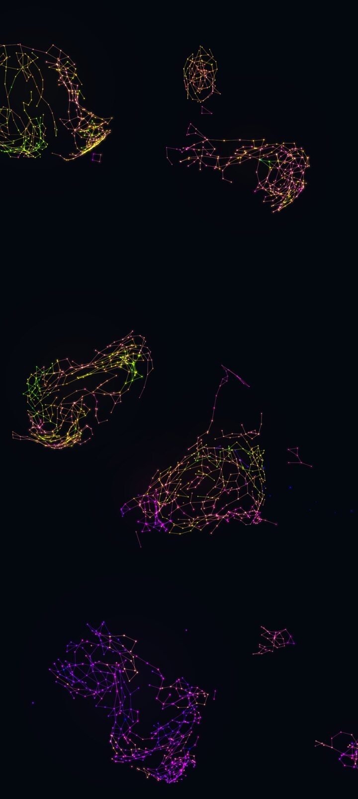

<div align="center">

# Koiros

### Lee Ostadi’s evolving computational wallpaper

Living mathematics. Slow currents. Color that unfolds.

[Download for Android](https://github.com/lostadi/koiros/releases/latest) · [Website](https://leeostadi.com/koiros/) · [Build it yourself](docs/BUILDING.md)

</div>

Koiros turns an Android background into a small, continuously evolving world.
In its default model every glowing dot obeys the same few equations: it bonds
to nearby dots up to its valence, keeps a rhythm with the dots it is bonded to,
gathers toward dots in step with it, circles, swims, and drifts in the current
of a hidden Game of Life world. Lattice bodies with crystal cores and lacy
rims, spiral arms, synchrony, fusion and division all arise from those rules.
Every line you see is a bond between two dots. The original Artificial Koi
forms remain available as the Classic model.

Created by **Lee Daghlar Ostadi**, building on **Artificial Koi** by
**Studio Coldstream / Mathew Molt** and **GoL Screensaver** by **Harold Martin**.
[Full credits and provenance](docs/CREDITS.md).

The name combines *koi* with *kairos*, the idea of the right or opportune
moment—a name for forms unfolding in their own time.

<p align="center"></p>

*An offscreen Android render of the Emergent lattice at full phone resolution, 150 pond seconds after a random start (run at Drift 0.5 to get there sooner); not a photograph of a phone.*

## Install and make it yours

1. On an Android device, open the [latest release](https://github.com/lostadi/koiros/releases/latest) and download **Koiros-3.2.apk** from Assets, or take [`apk/Koiros-3.2.apk`](apk/Koiros-3.2.apk) straight from this repository. It holds both models: the Emergent lattice (the default) and the Classic koi forms, under **Model**.
2. Open the APK. If Android asks, allow that browser or file manager to install apps, then install Koiros.
3. Open **Koiros**, adjust the preview, and tap **Set wallpaper**. Confirm in Android’s wallpaper picker.

Requires **Android 8.0 or newer** and live-wallpaper support. No root, account,
network connection, Ostadix installation, or paid service is required to run
the app. Home-screen and lock-screen options depend on the device.
[Compatibility and troubleshooting](docs/COMPATIBILITY.md).

For a calm starting point, keep **Drift** and **Shape evolution** at **0.18×**.
**Color drift** defaults to **0.25×**. Choose **1 Hz** for slower Life generations
or **4 Hz** for more frequent simulation updates; drawing runs independently.
The sliders reach **0.02×** for very gradual motion.

## What evolves

**Emergent lattice** (default):

- **Dots, not drawn shapes:** about 270 dots per lineage, each with a position, rhythm, colour, spin, depth and valence. Bonds form, breathe and snap by the dots' own rules; bodies are just connected groups of bonds. [The equations](docs/DYNAMICS.md).
- **Bodies that make themselves:** open lattices that take on rings, loops, crescents, curled arms and webs. Dots that can hold more bonds sort into crystal cores; dots that hold two or three make nets and lacy rims.
- **No collapse:** a continuous exclusion principle stops any body crushing itself. The pull together fades as packing nears critical, and pushes apart beyond it.
- **Heat:** a vertex crowded per bond it holds glows red, its most repulsive state. Hot vertices push apart and link outward, so clusters unfold into new shapes and cool as they spread.
- **Colour is kind:** a dot's colour sets its bond length, breathing, valence, swimming and mass. Colours flow steadily as gradients, every dot is drawn in its exact colour, every bond is a gradient between its dots, and each lineage keeps its own drifting colour, so fused bodies show patches of their lineages.
- **Fusion and division without a script:** bodies that fall into step attract and knit together. When their rhythms can no longer stay locked they drift apart again, and quorum sensing loosens any body that grows too large.
- **An open frame:** the screen is a window onto a larger pond. Groups of different sizes, shapes, densities, speeds and colours slide in from beyond the edges, and parts of bodies drift out.
- **Unison:** dots move to their own rhythm, so a body in step strokes and swells as one, with waves from its core. A slowly turning projection from two hidden dimensions makes forces come and go.
- **Touch:** drag to move and fling dots; tap and they startle outward in one bright beat.
- **Your apps are solid:** with **Collide with my apps**, dots bounce off the icons, folders, widgets and dock on your home screen, and bodies flow around them. It needs the optional *Koiros app collisions* reader in Accessibility settings, which reads only your launcher and keeps only shapes.
- **The whole screen:** bodies spread over all of it, start in a random arrangement every time, and look three-dimensional: near bodies larger and brighter, tilted like galaxies, with home-page parallax.

**Classic forms:**

- **Ten forms:** Koi, Jellyfish, Manta, Coral, Helix, Breathe, Bloom, Trance, Koi II, and Nebula, continuously morphing between one another.
- **One shared world:** every form lives in the same Conway Life world. Each senses the cells where it swims, seeds new life in its wake, and is carried by currents measured from the whole world's changing frequencies.
- **Merging and dividing:** forms that meet can fuse. Threads of light reach between them; rhythm, rotation, depth, colour and shape converge until they are one larger body. Later the body divides along a new axis and each form leaves with part of what it shared.
- **Colour in the water:** forms paint their hue into the unseen world and Life carries it onward, so colour travels between forms even when they never touch.
- **A companion:** tap the water and nearby forms drift over to look, more eagerly the more you play. Return after a while and they gather toward your thumb. Calmer at night, sleepy on a low battery, brighter while charging. With *Know my day*, the colours of the apps you spent time in arrive in the water when you come home — read on the phone only; Koiros has no internet permission.
- **One to nine forms:** keep a fixed count or let the population change gradually up to your chosen maximum.
- **Light that adds up:** additive neon blending, soft glow, hue-true auras, and a flash when bodies fuse or divide.
- **Ongoing dynamics:** coupled Lorenz systems keep driving visual evolution when the world settles; merged members share one chaotic rhythm.
- **A quiet background:** calm by default, independent speed controls, adaptive point density, pause while hidden, and 24 fps (20 in Battery Saver or on a low battery) once you stop touching the screen.

This is a simulation rendered on your device, rather than a prerecorded video.
Its chaotic driver and pattern renewal encourage continued variation; it does
not promise mathematically unique frames forever.

## Build and verify

The project is Java with Android framework APIs and Python standard-library
build tools. It has no Gradle, Maven, or third-party runtime dependencies.
Install the documented JDK and Android SDK, then run:

```sh
python3 tools/verify_reproducible.py
```

This runs all eleven simulation test suites and makes two clean builds, comparing
their APK bytes. Unsigned APKs are build artifacts; install the signed release
above or [sign your own build](docs/BUILDING.md).

Reproducibility means the **same source, toolchain, and build settings** produce
the same unsigned APK. Reproducing a signed APK also requires the same signing
key. Release assets include hashes, build metadata, and verification evidence.
The Android/Termux release toolchain and the Linux CI reference toolchain are
documented separately; their APKs are not assumed to match each other.

The Android package remains `org.ostadix.koilife` so Koiros can update the
earlier Koi / Life app with the same signing key and preserve saved controls.
The public version starts at **1.8**, continuing those development versions.

## Credits, privacy, and license

Koiros is released under **GPL-3.0-or-later**. Its corresponding source,
build scripts, and original upstream notices are included. The adapted GoL
component retains its MIT license. [Credits](docs/CREDITS.md) · [License](LICENSE).

The app has no Internet permission, advertisements, accounts, or analytics.
Preferences stay in Android app storage; Android’s own backup settings may
include them in system backup or device transfer. [Privacy details](docs/PRIVACY.md).

Ostadix supported development and numerical/rendering verification. It is an
optional development tool, not an app dependency. [How it works](docs/DYNAMICS.md)
and [releasing an update](docs/RELEASING.md).
